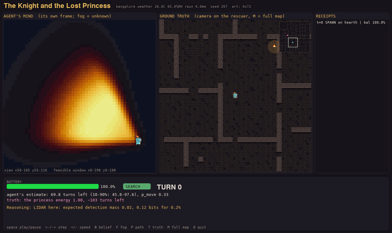
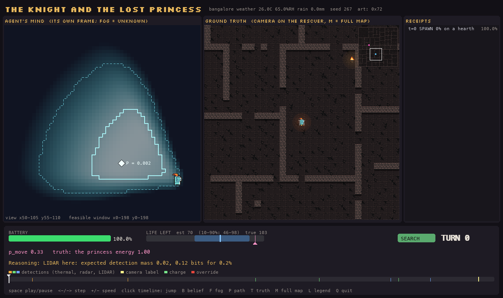
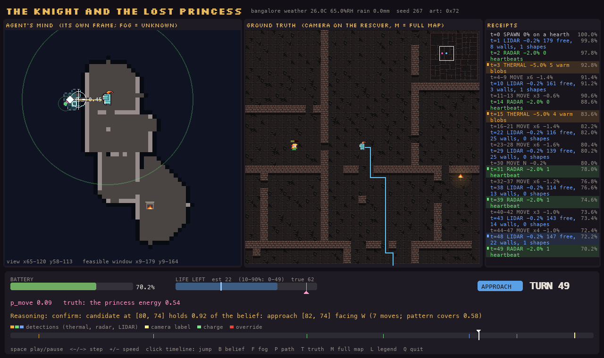
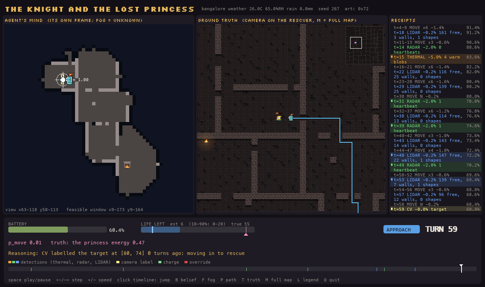
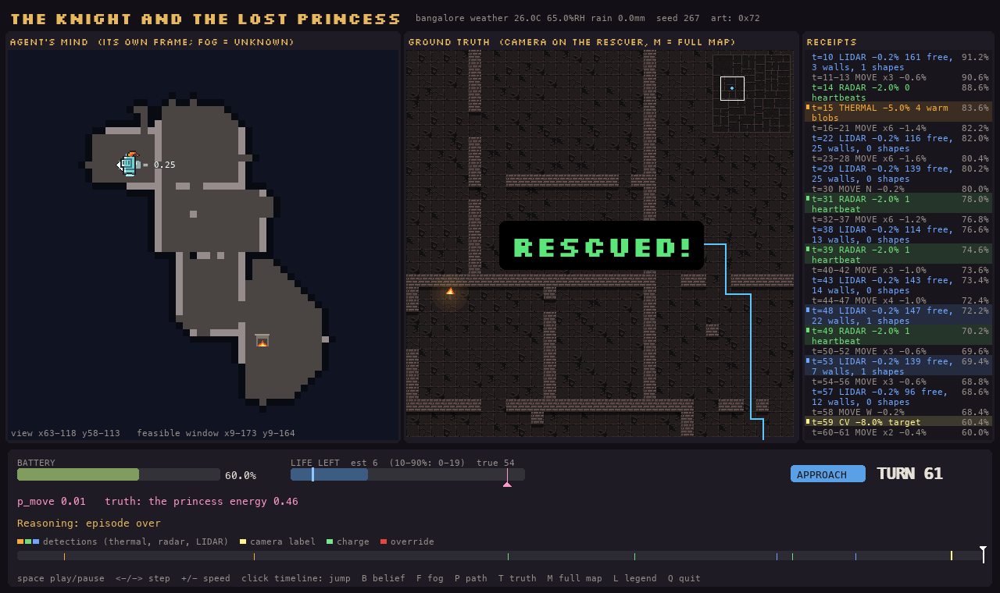
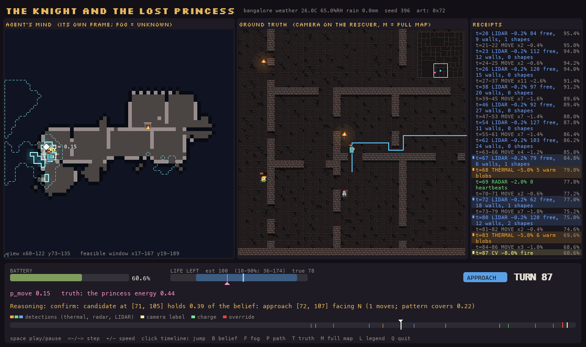
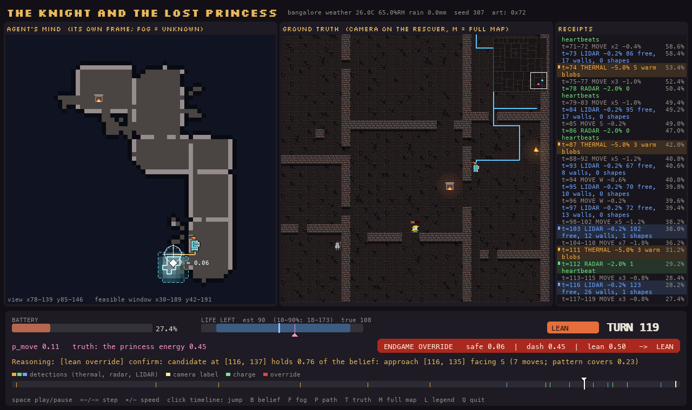
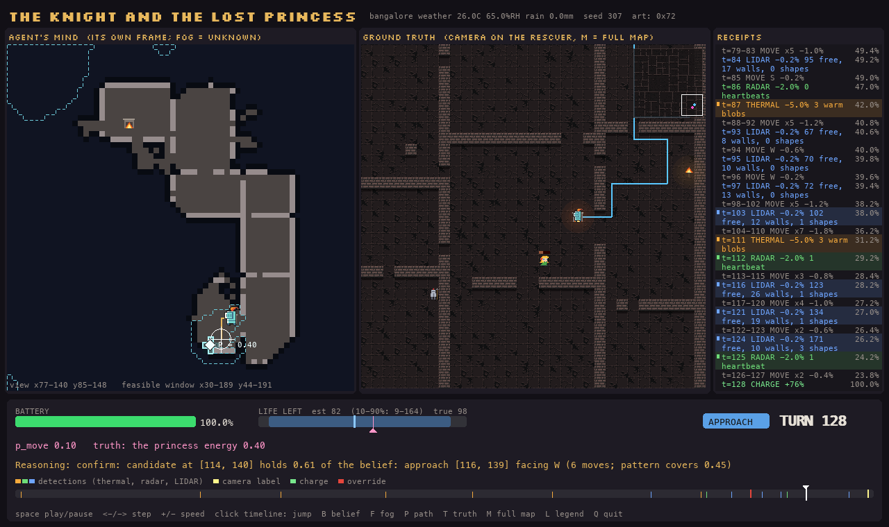

# WALL-E and EVE's Signal

An autonomous search-and-rescue agent in a simulated castle, with a pixel-art viewer.

A rescuer wakes on a hearth (charger) in a ruined castle it has never seen. All it has is one noisy distress
call from a lost target, somewhere 40-140 cells away. The rescuer has a battery and four sensors, and the
target is slowly running out of energy. It has to explore, tell her apart from dogs, braziers and suits of
armour, manage its battery, and decide when it is worth gambling to finish the rescue.

The default skin is a knight looking for a lost princess (`theme: castle`); `theme: walle` swaps in
WALL-E and EVE style robots. The code itself uses neutral names (`agent`, `target`).



*`samples/clean_rescue` (seed 267). Left: what the agent believes (fog = unknown, heat = where it thinks
she is). Middle: the truth. Right: every battery "purchase". The belief closes in on her room, LIDAR and
radar check the candidate, the camera (CV) confirms, and the knight steps in at turn 61.*

**Contents:** [What it does](#what-it-does) · [Screenshots](#screenshots) · [Install](#install) ·
[How to run](#how-to-run) · [Results](#results) · [The world](#the-world) ·
[Actions and sensors](#actions-and-sensors) · [Observations and config](#observation-format) ·
[Information boundary](#the-information-boundary) · [How the agent thinks](#how-the-agent-thinks) ·
[Outputs](#outputs-of-a-run) · [Repo layout](#repo-layout) · [Limitations](#known-limitations)

---

## What it does

| Task requirement | Where |
|---|---|
| Environment from a config file | one YAML per mission, every number a variable (`configs/default.yaml`); presets inherit with `extends:` |
| Agent receives observations only | `agent/` never imports the world ([Information boundary](#the-information-boundary)) |
| Belief updates | a Bayesian probability map over every cell, updated by each scan's likelihood ratio |
| Clue gathering | LIDAR, radar, thermal and a camera (CV), chosen by expected information per % of battery |
| Battery management | a safety rule that always keeps enough charge to get home, one-turn recharges on hearths, and an endgame override that weighs a risky dash against going home |
| Locate the target | belief peak → confirmation sequence (LIDAR → radar → CV) → rescue |
| Trace logging | `trace.jsonl`: every turn's action, observation, belief summary and a one-sentence reason |
| Mission report | `report.md` / `report.json` written from the agent's own knowledge, then a ground-truth comparison |
| Bonus: decoys | dogs (heartbeat), braziers and hearths (heat), suits of armour (human shape) |
| Bonus: noisy sensors | bearing noise, blurred positions, false alarms, shape confusion, persistent thermal noise, live weather |
| Bonus: generalisation | random castles per seed, three weathers, three life budgets; evaluated on 1,350 missions |
| Visualisation | pygame viewer: replay, play as either side, GIF export |

---

## Screenshots

| | |
|---|---|
|  **Turn 0.** The distress call gives a bearing cone: the cool glow is the belief, the solid and dashed outlines its 50% and 90% likely areas. The agent knows nothing about the map yet. |  **Searching.** The belief has narrowed to one room; the agent has mapped what it walked through and pings it with radar (the green ring) before going in. |
|  **Confirming.** From a viewpoint with line of sight, the camera (its 4 cells outlined) labels the target. |  **Rescued** at turn 61; she had 116 turns of life in total. |
|  **A decoy.** A brazier looked like a warm person to thermal; the camera labels it `fire` (the highlighted receipt), and the belief moves on. |  **Endgame override.** At 27% battery, going home now scores 0.06 and a lean dash 0.50, so the agent gambles. The banner has its own row under the battery and life bars. |
|  **Recharge on the way.** A hearth found during the dash refills the battery in one turn (the green timeline marker); she is rescued at turn 139. | |

**Reading the viewer.**
- **Agent's mind (left):**
  - **Belief:** one cool teal glow. Brighter means more likely, and it is invisible below 1% of the peak. The solid
    outline is the smallest area holding 50% of the belief, the dashed one 90%, and the white diamond is the most
    likely cell with its probability.
  - **Fog:** the dark blue is unknown ground, with a darker band where the map ends.
  - **Scans:** each scan sends a ring out from the knight: thermal amber, radar green, LIDAR blue. What it finds
    appears as the ring reaches it. The camera outlines the 4 cells it looks at.
  - **Tracks:** circles coloured by what the agent thinks they are.
- **Warm colours** (amber, orange, red) always mean heat and fire. The braziers and hearths on the truth side glow,
  and the belief never uses these colours.
- **Bottom bar:**
  - **Battery and life bars:** the life bar is the agent's estimate of her remaining life, with its 10-90% band
    shaded; the pink tick is the true value.
  - **Timeline:** the whole mission, with markers for detections, camera labels, charges and overrides. Click it in
    `replay` to jump.
- **Legend:** `L` shows one.

---

## Install

Needs Python 3.12 or newer. Tested on macOS (Apple silicon) and Linux.

```bash
git clone <this repo> && cd <repo folder>
python3 -m venv .venv
source .venv/bin/activate          # Windows: .venv\Scripts\activate
pip install -r requirements.txt
```

**Art (optional).** Without an art pack, everything is drawn procedurally in a 16x16 pixel style, so the
game always runs. For nicer sprites:

- `python -m signalsearch fetch-assets` downloads Kenney's *Tiny Dungeon* (CC0) into `assets/`.
- Or download `0x72_DungeonTilesetII_v1.7.zip` from https://0x72.itch.io/dungeontileset-ii (CC0) and drop
  the zip into `assets/`. It is unpacked automatically and preferred. The screenshots above use it.

Neither pack is included in this repo.

---

## How to run

### One mission

```bash
python -m signalsearch run --seed 7                      # headless, saves runs/<timestamp>_seed7/
python -m signalsearch replay runs/<that folder>         # watch it in the viewer
python -m signalsearch replay runs/<that folder> --gif out.gif
```

`run` prints a one-line summary (outcome, turns, battery) and writes the trace, the report and everything
the viewer needs. Open `runs/<folder>/report.md` for the agent's mission report.

### Watch the showcase runs

```bash
python -m signalsearch replay samples/clean_rescue       # clean rescue
python -m signalsearch replay samples/decoy_recovery     # a brazier fools thermal, CV sorts it out
python -m signalsearch replay samples/override_recharge  # endgame gamble + recharge on the way
```

### Play it yourself

```bash
python -m signalsearch play --as target --seed 3    # you are the princess; the knight hunts you
python -m signalsearch play --as rescuer --seed 3   # you are the knight, seeing only what it senses
```

### Many missions, charts and diagnosis

```bash
python -m signalsearch batch --seeds 1-20 --jobs 4                     # 20 missions in parallel
python -m signalsearch batch --seeds 1-20 --weathers bangalore,humid,vellore --jobs 4
python -m signalsearch analyze runs/batch_<timestamp>                  # charts + summary.md
python -m signalsearch diagnose runs/<run or batch folder> --jobs 4    # whole-mission pattern report
```

### Change anything

Every number is in the config. Override any of them on the command line, or write a preset:

```bash
python -m signalsearch run --seed 7 --set world.target.k=2.0              # more life for the target
python -m signalsearch run --config configs/vellore_hard.yaml --seed 7    # heat, more decoys, less life
python -m signalsearch run --seed 7 --set theme.name=walle                # robot skin
python -m signalsearch run --seed 7 --set world.weather.source=fixed      # offline weather
```

The same seed and config always give the identical run. Each run saves `config.resolved.yaml` with every
value filled in (fetched weather, all random seeds), and running that file replays the mission exactly,
offline.

### Viewer controls

| Mode | Keys |
|---|---|
| `replay` | space play/pause, ←/→ step, +/- speed, click the timeline to jump, `B` belief, `F` fog, `P` path, `T` truth, `M` full map / camera, `L` legend, `Q` quit |
| `play --as rescuer` | arrows move, `Q`/`E` turn, `L` lidar, `R` radar, `T` thermal, `C` cv, `H` charge, space wait, `G` legend |
| `play --as target` | arrows/WASD move the princess (she stays put if you press nothing), `P` pause, `L` legend |

---

## Results

### 1,350 missions

Seeds 251-400 (castles never used while building the agent) × three fixed weathers × three life budgets.
Rescue rate (95% interval):

| weather | k = 1.3 | k = 2.0 | k = 3.25 | all k |
|---|---|---|---|---|
| Bangalore 26 C / 65% RH | 47% (40-55) | 59% (51-66) | 73% (66-80) | 60% |
| humid 21.8 C / 80% RH | 39% (32-47) | 57% (49-64) | 73% (65-79) | 56% |
| Vellore 36 C / 55% RH | 53% (45-60) | 63% (55-71) | 70% (62-77) | 62% |
| **all weathers** | **46%** | **60%** | **72%** | **59.3%** (57-62) |

`k` scales the target's life: k = 1.3 gives her 1.3× the time a mission designer would expect a good
rescue to take, so it is the hardest setting. Reproduce with
`batch --seeds 251-400 --weathers bangalore,humid,vellore --set world.target.k=<k>`.

### How the agent got here

| version | rescue rate (k = 1.3 / 2.0 / 3.25) | what changed |
|---|---|---|
| First build | 47% / 42% / 52% (seeds 1-100) | belief map, planner, safety rule, endgame override. More life *lowered* success at k = 2.0, which pointed to stalls |
| Iteration 2 | 52% / 56% / 75% (seeds 1-100) | diagnosed whole missions instead of averages: one-turn full charging (ended a charging loop), the reserve may be spent on the final CV, an override that discounts delay and visits nearby spots first, an approach watchdog, line-of-sight viewpoints, no idling |

### 60 recorded missions (seeds 1-20, Bangalore weather)

Reproduce with `batch --seeds 1-20 --set world.target.k=<k> --set world.weather.source=fixed`, then `analyze`.

| | k = 1.3 | k = 2.0 | k = 3.25 |
|---|---|---|---|
| Rescued | **12 / 20** | 10 / 20 | 17 / 20 |
| Life used by successful rescues (median) | 74% | 51% | 59% |

At k = 1.3: 7 times the target died first (3 never localized, 4 localized but not confirmed in time) and 1
battery ran out inside an accepted dash. 20 seeds is a small sample: k = 2.0 scoring below k = 1.3 here is
seed-to-seed noise, and the 1,350-mission table above is the reliable estimate.

What the runs show:

- **Time is the scarce resource, not battery.** Moving is the biggest spend (25% per mission), then thermal
  (17%) and CV (12%). Recharges are rare (0.1 per mission) now that a charge is one turn to full.
- **Braziers fool thermal and dogs fool radar.** A distant fire behind unknown walls looks like a nearby
  person to thermal, and a heartbeat is a heartbeat. LIDAR shape, a radar check and finally CV separate them.
- **Finding the door is the hard part.** Once the belief is on her room, the remaining risk is the route in.
- **The override fires often near the end.** 45 evaluations in 10 of the 20 missions at k = 1.3, every one
  logged with its three scores (table in the summary).

---

## The world

**Castle.** A 100×100 grid (1 cell = 1 m) with an outer wall. The interior is split by BSP into rooms
separated by 1-cell walls, with doors in every wall (1-2, plus one per 15 cells of length). One or two
large spaces stay undivided as courtyards, and a few rubble pillars are scattered around. Every map is
checked for connectivity. The rescuer and target spawn 40-140 cells apart, and a hearth always sits at the
rescuer's spawn.

**Entities** (all counts configurable):

| Entity | Surface temp | Heartbeat | LIDAR shape | CV label | Moves |
|---|---|---|---|---|---|
| Target (human) | 34 C | yes | humanoid | `target` | p_move = p0 × energy |
| Dog (1-2) | 38 C | yes | small | `dog` | p = 0.7 |
| Torch / brazier (4-6) | 320 C | no | small | `fire` | no |
| Hearth (3-4) | 520 C | no | box | `hearth` | no |
| Suit of armour (2-3) | ambient | no | humanoid | `armour` (10% `target` from the far row) | no |

**Target life.** Energy starts at 1.0 and drains `d` per turn standing still, `2d` when moving, with
`p_move = 0.3 × energy`. Each map gets a fair life: `T_expected = 1.5 × 1.2 × d_path + 10 + charging
allowance`, `life = round(k × T_expected)`, and `d = 1 / (1.15 × life)`. When her energy reaches 0 the
mission ends.

**Weather.** Fetched once from Open-Meteo (Bangalore by default, Vellore in `configs/vellore_hard.yaml`)
and written into the resolved config. If the fetch fails, fixed values are used and the fallback is logged.
Humidity and rain weaken thermal and shorten LIDAR. Ambient temperature sets thermal contrast: in Vellore's
36 C heat, a dog at 38 C almost disappears.

**Distress call.** Emitted 0-30 turns before t = 0. It gives a bearing from the rescuer's spawn to where the
target was then (±25° noise) and a strength `1/(1+(d/30)²) × lognormal(0.25)`.

## Actions and sensors

| Action | Cost | What it returns |
|---|---|---|
| `move N/E/S/W` | 0.2% + 0.2% per 90° turned | `blocked: true` if a wall |
| `turn L/R` | 0.2% | changes facing (for CV) |
| `lidar` | 0.2% | ~10 m, line of sight: free cells, wall cells, shape blobs (humanoid / small / box) |
| `radar` | 2% | 20 m through walls (×0.92 per wall): heartbeats, ±2 cells, 3% false alarms |
| `thermal` | 5% | 50 m: warm blobs `{pos, radius, strength}` |
| `cv` | 8% | the cell ahead + the 3-cell row beyond, line of sight: class labels |
| `charge` | refills to 100% | one turn, only on a hearth |
| `wait` | 0% | |

**Thermal model.** `strength = c/(c+4) × 1/(1+(d/20)²) × 0.6^walls × exp(-(0.00012 RH + 0.004 rain) d)`,
with `c = |T - ambient|`. Position blur sd is `1 + d/10` cells. 75% of the noise is a fixed per-map field,
so scanning again from the same spot adds little.

**Rescue** is granted when the agent enters the target's cell within 10 turns of a CV `target` label.

## Observation format

Every `env.step(action)` returns one JSON-serialisable `Observation` in the agent's own frame, containing
only what that action could sense:

```json
{"t": 57, "action": "thermal", "cost": 5.0, "battery": 61.4, "pose": [104, 92], "facing": "E",
 "blocked": false, "on_hearth": false, "charged": 0.0,
 "readings": {"thermal": [{"pos": [131, 88], "radius": 3, "strength": 0.42}]},
 "episode": {"done": false, "reason": null}}
```

`readings` holds `lidar: {free, walls, blobs}`, `radar: [{pos, radius}]`, `thermal: [...]` or
`cv: {visible, walls, labels}`. The t = 0 observation also carries `initial_signal`
`{bearing_deg, strength, age}` and `weather` `{temperature, humidity, rain}`. `episode.reason` is one of
`rescued`, `target_died`, `step_cap`, `battery_depleted`.

## Config format

One YAML per mission (annotated excerpt; every key is in [`configs/default.yaml`](configs/default.yaml)):

```yaml
seed: 7
max_steps: 2000                  # backstop
world:                           # GROUND TRUTH - the agent never sees this section
  map: {size: 100, min_room: 7, max_room: 20, courtyards: [1, 2], doors_per_wall: [1, 2], door_every: 15}
  spawn: {min_dist: 40, max_dist: 140}
  entities: {hearths: [3, 4], torches: [4, 6], armour: [2, 3], dogs: [1, 2]}
  temps: {human: 34.0, dog: 38.0, torch: 320.0, hearth: 520.0}
  target: {p0: 0.3, k: 1.3, drain_multiplier: 1.0, drain_fudge: 1.15, room_bias: 3.0}
  signal: {max_age: 30, bearing_noise_deg: 25.0, d0: 30.0, strength_noise: 0.25}
  sensors: {lidar: {...}, radar: {...}, thermal: {...}, cv: {...}}   # TRUE sensor specs
  costs: {move: 0.2, turn_per_90: 0.2, lidar: 0.2, radar: 2.0, thermal: 5.0, cv: 8.0}
  weather: {source: live, location: bangalore, fixed: {...}}
agent_assumed:                   # the agent's BELIEFS: every sensor/temperature/signal/target number is
  perturb: 0.10                  #   true x U(0.9, 1.1) (seeded); costs and map size are exact
  life_prior_cv: 0.3
  signature_counts: {dog: 1.5, torch: 5.0, armour: 2.5, hearth: 3.5}
agent:                           # the agent's own policy knobs
  reserve: 3.0                   # % kept beyond the 0.4%/cell bound for getting home
  hysteresis: 0.10               # a risky plan must beat Safe by this much
  override: {enabled: true, samples: 30, p_confirm: 0.85, restart_value: 0.5}
  planner: {...}
  charging: {opportunistic_below: 90}
  approach: {stall_turns: 12, unknown_cost: 4.0, view_radius: 4, cooldown: 40}
theme: {name: castle, rescuer_sprite: knight_m, target_sprite: princess}   # or name: walle
```

## The information boundary

The agent may only know what it is told a priori or what arrives in an Observation.

- `world/` holds all ground truth. `agent/` imports **only** from `common/` (actions, observation, config,
  pure geometry). `sim/runner.py` is the only place the two meet: `action = agent.act(observation)`,
  `observation = env.step(action)`.
- The agent is built from the `agent` and `agent_assumed` sections only. Its a-priori knowledge: the map is
  100×100 with 4-connected moves, its own pose by dead reckoning in a 199×199 frame starting at (99, 99),
  action costs, the assumed sensor specs, the form of the target's energy model, and the distress call and
  weather in the first observation.
- Because of this split, a run can be replayed from its logged observations alone, with the world code
  never loaded, and the agent makes exactly the same decisions.
- `report.md` / `report.json` are written from agent state only. `sim/evaluate.py` then appends the
  "Ground truth comparison" section and writes `eval.json`.

## How the agent thinks

**Frame and pruning.** The agent doesn't know where it is on the map. Every cell it learns is inside the
map (stood on, seen free or seen as wall) narrows down where the 100×100 map can lie. Everything outside
that window gets belief 0. Once the known extent spans exactly 100 cells, the offset is resolved and the
report also gives true-map coordinates.

**Belief.** A probability for every cell, started from the distress call: a ±25° cone along the bearing,
times a band in distance from the signal strength, blurred for how far she may have walked since.

- **Predict.** Each turn, a share `p_move_estimate` of each cell's probability moves to its walkable
  neighbours.
- **Update.** Multiply and normalise. Each scan contributes, for the cells inside its coverage only:

      LR(c) = P(reading | target in c) / P(reading | target not here)
            = (1 - p_det(c)) + Σ_j density_target(blob_j | c) / density_clutter(blob_j)

  `p_det(c)` uses the assumed sensor specs, the observed weather and the walls in between (known walls,
  plus an expected count through unknown space). Clutter density comes from how many dogs, braziers,
  armours and hearths a castle usually holds and what each does to each sensor. Sources already seen count
  as clutter known to exist. So a decoy that trips one sensor moves the belief little, and only the full
  signature (warm + heartbeat + humanoid + CV `target`) concentrates it.
- **Floor.** 0.1% of the probability is re-spread after every update, so a wrong assumption can never rule
  out the true cell forever.

**Fusion and tracks.** One sensor fires per turn. Detections within 6 turns whose regions overlap merge
into a track with an inverse-variance position. Each track builds a signature (hits per sensor, CV labels)
and a speed estimate. Only CV labels prove identity.

**Motion and life.** How often she moves is learnt from re-sightings of target-like tracks. Her remaining
life is a distribution: the fairness formula applied to the agent's own distance estimate, with a
lognormal spread, updated by the observed movement rate.

**Distance fields.** Vectorised BFS wavefronts on the feasible window: an exploration field from the
agent's cell (unknown cells treated as free) and a home field from known hearths over known-free cells
only, so the way home is always a real route.

**Safety rule.** Before every action: `battery - cost - 0.4% × (moves home afterwards) - reserve ≥ 0`. If
nothing passes, the agent walks home and recharges, unless the endgame override fires.

**Planner.** Candidate scan positions (a 3-cell grid plus the belief peaks) are scored for every sensor at
once: an FFT convolution of the belief with each sensor's detection kernel gives the expected detected
probability `q_s(p)`.

- Position: `argmax q_s(p) / (travel(p) + cost_s)`, among plans that can still get home.
- Sensor: the one with the best expected information gain per % spent.
- No new thermal scan within 6 cells of an old one, because its noise is persistent. LIDAR before stepping
  into unknown space.
- **Confirmation.** A strong candidate (≥ 35% of the belief within 2 cells, a humanoid + heartbeat track,
  or a fresh heartbeat nearby) is checked in order: LIDAR, radar (alive or not?), then the viewpoint and
  facing whose camera pattern covers the most belief with line of sight, then CV. After a CV `target`
  label, step into her cell.
- **Watchdogs.** After 12 turns without getting closer to the viewpoint, the agent routes over known floor
  and doors only, then gives up that viewpoint, then puts the candidate on a cooldown. 15 turns with no
  new information forces an approach or a replan. Every escalation is logged.

**Charging.** One turn on a hearth refills to 100%. The agent charges when the safety rule sent it home,
or when it is already standing on a hearth below 90%.

**Endgame override.** When the safety rule would force a trip home, the agent compares three plans:

- **Safe**: go home, charge, come back.
- **Dash**: go now, thermal + CV at each likely location.
- **Lean**: as Dash, with CV only.

Each is scored as `Σ_locations belief × retained(delay) × P(alive at arrival) × P(battery lasts) ×
P(confirm)`, where `retained` is how much of a location's probability is still there after she wanders
for the delay. A risky plan replaces Safe only if it scores at least 0.10 higher. Every evaluation is
logged with all three scores.

## Outputs of a run

`runs/<timestamp>_seed<N>/`:

| File | Contents |
|---|---|
| `config.resolved.yaml` | every value, including weather and seeds; re-running it replays the mission |
| `trace.jsonl` | one line per turn: action, cost, battery, observation, mode, a one-sentence reason, plan and route, top-5 candidate scan positions, safety check, approach state, events, override scores, fused detections, belief summary, movement and life estimates |
| `truth.jsonl` | per-turn ground truth, for the viewer and evaluator only |
| `beliefs.npz` | per-turn belief and occupancy, for `replay` |
| `world.npz`, `world.json` | map and static truth, for the viewer |
| `report.md` / `report.json` | the agent's mission report, then the evaluator's ground-truth comparison |
| `eval.json` | metrics used by `analyze` |
| `diagnosis.md` / `.png` / `.json` | from `diagnose`: timeline, pattern detectors (charging loops, oscillation, plan churn, idling, stalled confirmations), distance / belief / battery over time |

## Repo layout

```
configs/      default.yaml, vellore_hard.yaml, sample_mission.yaml, weather_{bangalore,humid,vellore}.yaml
signalsearch/
  common/     actions, observation, config, geometry (shared, truth-free)
  world/      mapgen, entities, target, weather, sensors_true, env
  agent/      frame, occupancy, belief, sensors_assumed, fusion, motion_estimate, fields,
              safety, planner, charging, override, report, agent
  sim/        runner, logger, evaluate
  viz/        viewer, assets, themes, replay, play, gif_export
  analysis/   analyze, diagnose
samples/      three showcase runs (clean rescue, decoy recovery, override + recharge)
docs/         screenshots
```

## Known limitations

- **Early search is the biggest loss.** The distress call's ±25° cone is wide at long range, and some
  searches never get the belief near her before her life runs out.
- **Hidden doors.** The agent can know which room she is in but not where its door is. It explores the
  room's perimeter optimistically and can run out of time.
- **Battery depletion** happens only inside an accepted risky dash; the safety rule alone never lets the
  battery reach 0.
- **The outer wall can't be detected directly.** LIDAR can't tell it from interior walls, so the
  outer-wall routing rule is a heuristic.
- **Priors are calibrated on castles from this generator** (walking/straight-line ratio about 1.4). A very
  different map family would need new priors.
- **Single agent only**; the target doesn't react to the rescuer (except in `play --as target`).

## Credits

- Art: Kenney *Tiny Dungeon* and 0x72 *16x16 DungeonTileset II*, both CC0, downloaded separately. Braziers,
  hearths, dogs, armour and the robot skin are drawn procedurally.
- Font: [Silkscreen](https://github.com/googlefonts/silkscreen) (The Silkscreen Project Authors), SIL Open Font License 1.1
  (`assets/fonts/OFL.txt`), for titles and headings; numbers and logs use the system monospace font.
- Weather: [Open-Meteo](https://open-meteo.com/).
- macOS note: the pygame loop pumps events every frame, and OpenCV is not used (its bundled SDL2 conflicts
  with pygame's).
