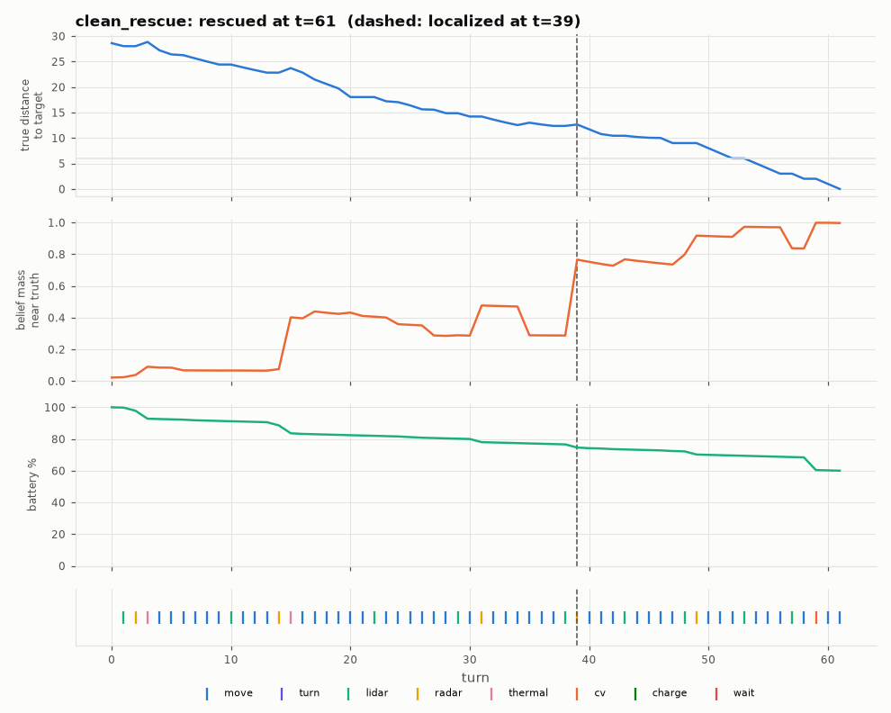

# Diagnosis: clean_rescue

Outcome **rescued** after 61 of 116 life turns; battery at the end 60.0%. Closest approach to the target: 0.0 cells (10 turns within 6).

## Timeline

- t=39: **localized** (belief >= 50% within 2 cells of the truth)
- t=59: CV from [82, 74] facing W -> ['target'] (saw target)
- end t=61: rescued, battery 60.0%

Mode sequence: t=0-14 search; t=15-60 approach; t=61 end

## Pattern detectors

| pattern | found | evidence |
|---|---|---|
| charging loop (>= 2 consecutive excursions < 20 turns) | False | - |
| oscillation (<= 4 cells in 20 turns) | False | t=- |
| plan churn (>= 5 goal changes in 20 turns) | False | t=- (5 goal changes total) |
| idle streaks (>= 5 zero-progress turns) | False | t=- |
| near but not closing | False | t=- |
| CV that could not see the target | False | - |
| confirm sequence stalled before CV | False | - |
| no CV at all after localization | False | |

## Actions

| action | whole mission | after localization |
|---|---|---|
| cv | 1 | 1 |
| lidar | 9 | 4 |
| move | 44 | 16 |
| radar | 5 | 1 |
| thermal | 2 | 0 |

Hearth excursions: 1 (0 under 20 turns); charge actions: 0; override evaluations: 0; escalations: 0; near-failing safety checks: 0.

