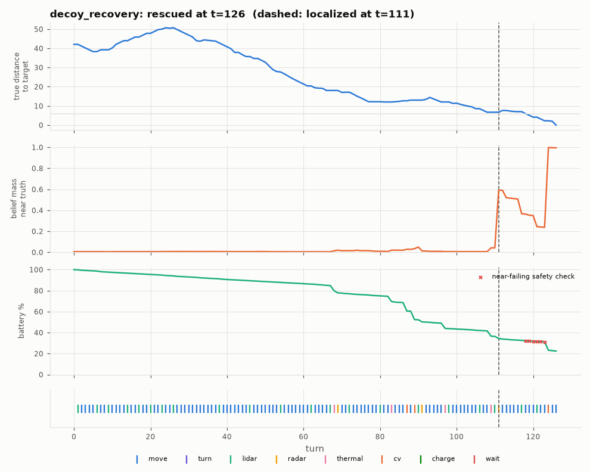

# Diagnosis: decoy_recovery

Outcome **rescued** after 126 of 174 life turns; battery at the end 22.4%. Closest approach to the target: 0.0 cells (9 turns within 6).

## Timeline

- t=111: **localized** (belief >= 50% within 2 cells of the truth)
- t=87: CV from [72, 108] facing N -> ['fire'] (target far (13 cells))
- t=89: CV from [72, 107] facing N -> nothing (target far (13 cells))
- t=124: CV from [60, 111] facing S -> ['target'] (saw target)
- end t=126: rescued, battery 22.4%

Mode sequence: t=0-67 search; t=68-71 approach; t=72-82 search; t=83-90 approach; t=91-110 search; t=111-122 approach; t=123-125 lean; t=126 end

## Pattern detectors

| pattern | found | evidence |
|---|---|---|
| charging loop (>= 2 consecutive excursions < 20 turns) | False | - |
| oscillation (<= 4 cells in 20 turns) | False | t=- |
| plan churn (>= 5 goal changes in 20 turns) | False | t=- (11 goal changes total) |
| idle streaks (>= 5 zero-progress turns) | False | t=- |
| near but not closing | False | t=- |
| CV that could not see the target | False | t=87 target far (13 cells); t=89 target far (13 cells) |
| confirm sequence stalled before CV | False | - |
| no CV at all after localization | False | |

## Actions

| action | whole mission | after localization |
|---|---|---|
| cv | 3 | 1 |
| lidar | 21 | 2 |
| move | 95 | 12 |
| radar | 3 | 0 |
| thermal | 4 | 0 |

Hearth excursions: 2 (1 under 20 turns); charge actions: 0; override evaluations: 1; escalations: 0; near-failing safety checks: 6.

