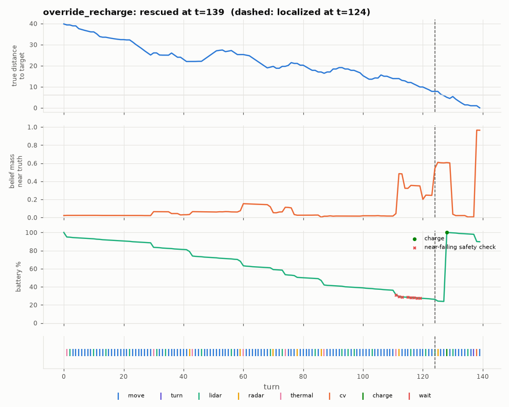

# Diagnosis: override_recharge

Outcome **rescued** after 139 of 236 life turns; battery at the end 89.8%. Closest approach to the target: 0.0 cells (13 turns within 6).

## Timeline

- t=124: **localized** (belief >= 50% within 2 cells of the truth)
- t=138: CV from [116, 139] facing W -> ['target'] (saw target)
- end t=139: rescued, battery 89.8%

Mode sequence: t=0-111 search; t=112-118 approach; t=119-126 lean; t=127 search; t=128-138 approach; t=139 end

## Pattern detectors

| pattern | found | evidence |
|---|---|---|
| charging loop (>= 2 consecutive excursions < 20 turns) | False | - |
| oscillation (<= 4 cells in 20 turns) | False | t=- |
| plan churn (>= 5 goal changes in 20 turns) | False | t=- (11 goal changes total) |
| idle streaks (>= 5 zero-progress turns) | False | t=- |
| near but not closing | False | t=- |
| CV that could not see the target | False | - |
| confirm sequence stalled before CV | False | - |
| no CV at all after localization | False | |

## Actions

| action | whole mission | after localization |
|---|---|---|
| charge | 1 | 1 |
| cv | 1 | 1 |
| lidar | 20 | 2 |
| move | 102 | 9 |
| radar | 7 | 1 |
| thermal | 7 | 0 |
| turn | 1 | 1 |

Hearth excursions: 2 (0 under 20 turns); charge actions: 1; override evaluations: 1; escalations: 0; near-failing safety checks: 8.

